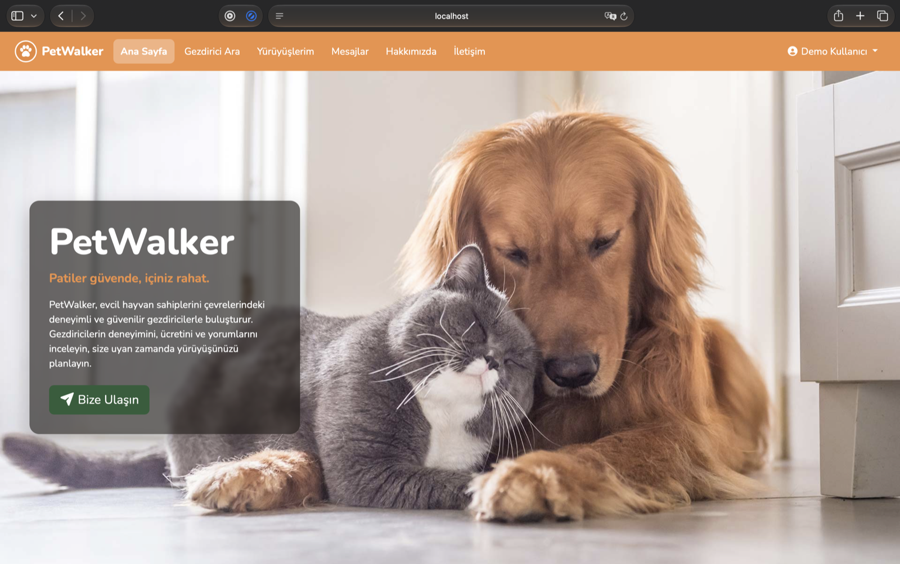
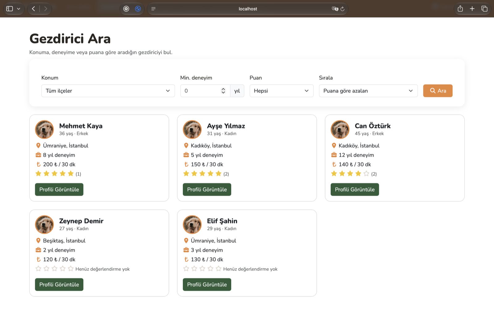
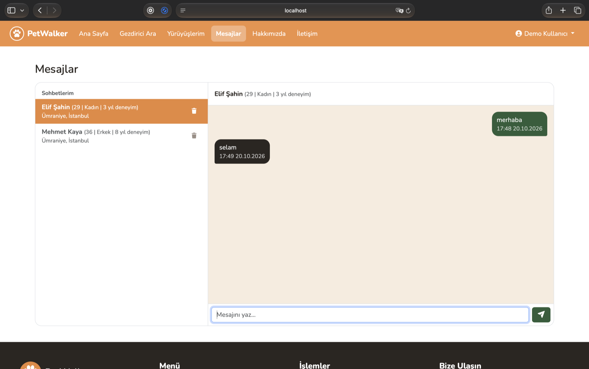
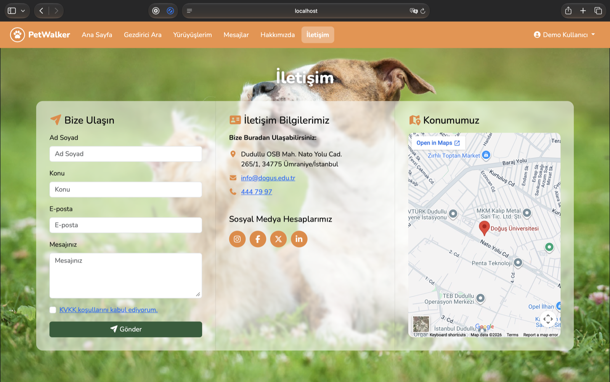

# PetWalker Web Platform V2

A web platform that connects pet owners with dog walkers in Istanbul. Owners can search for walkers, book walks, message walkers, and rate walkers after a walk. This is a rewrite of our 2023 school final project, originally built with ASP.NET MVC 5 on .NET Framework 4.7.2. V2 moves it to ASP.NET Core on .NET 10, so it runs on Windows, macOS and Linux. It also adds a redesigned interface, new features such as booking requests and walk ratings, SMTP email support and automated tests.

## Features

- **Account:** Sign up, sign in, password reset, profile management and profile photo.
- **Pet Management:** Add, edit or delete pets.
- **Become a Walker:** Set experience, price, description, and available durations (30 min, 1 hour, 2 hours).
- **Walker Search:** Filter and sort walkers by location, experience, rating, and price.
- **Booking Requests:** Send, accept, or reject walk requests. Overlapping bookings are prevented.
- **My Walks:** View walk statuses, contact walkers or owners, cancel upcoming walks, delete cancelled walks, and rate completed walks.
- **Messaging:** Private conversations between pet owners and walkers.
- **Contact Form:** Save messages to the database and display the campus location on a map.
- **Privacy & Security:** KVKK consent, hashed passwords, and IP-based rate limiting for sign-in and forms.

## Screenshots

| Home | Walker search |
|---|---|
|  |  |

| Messages | Contact |
|---|---|
|  |  |

## Technologies

| Layer | Technology |
|---|---|
| Backend | ASP.NET Core MVC (.NET 10, C#) |
| Data | Entity Framework Core 10 |
| Database | SQLite |
| Frontend | Razor views, Bootstrap 5.3.8, Font Awesome 7.3.1 |
| Security | Password hashing (PBKDF2), anti-forgery tokens, cookie auth |
| Testing | xUnit |

## Setup

Requirement: the [.NET 10 SDK](https://dotnet.microsoft.com/download).

```bash
git clone https://github.com/ozgun-ozdemir/PetWalker-Web-Platform.git
cd PetWalker-Web-Platform
dotnet run --project src/PetWalker --launch-profile http
```

Then open <http://localhost:5179>.

The database is created on first run, with sample walkers and two demo accounts:

- `demo@petwalker.test` – pet owner
- `gezdirici@petwalker.test` – walker

Password for both: `Demo1234!`

### Database

Database changes are managed with EF Core migrations. To add a migration:

```bash
dotnet tool install -g dotnet-ef   # once
dotnet ef migrations add <Name> --project src/PetWalker
```

The SQL schema is available in `database/schema.sql`. To reset the database, delete `src/PetWalker/petwalker.db` and restart the app.

## Automated tests

```bash
dotnet test
```

## Email

Emails (for example a new password) are written to the console until SMTP is configured. To send real email, for example with SendGrid:

```bash
cd src/PetWalker
dotnet user-secrets set "Email:Host" "smtp.sendgrid.net"
dotnet user-secrets set "Email:From" "you@example.com"
dotnet user-secrets set "Email:Password" "<your SendGrid API key>"
```

## Project layout

```
src/PetWalker/
  Controllers/   Home, Account, Pets, Walkers, Walks, Chat
  Data/          DbContext, migrations, development seed data
  Models/        Customer, Pet, Walker, Walk, Message, ContactMessage
  ViewModels/    Form models and validation rules
  Services/      Email sending, current user helper
  Views/         Razor views
  wwwroot/       CSS and images
tests/PetWalker.Tests/   xUnit integration tests
database/schema.sql
```

## Pathway

- An admin panel (manage users and walkers, read contact-form messages).
